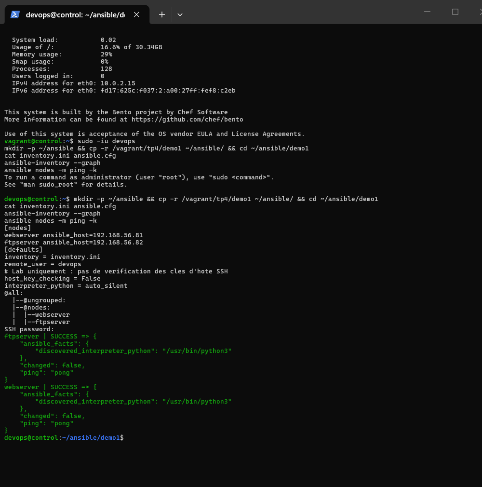
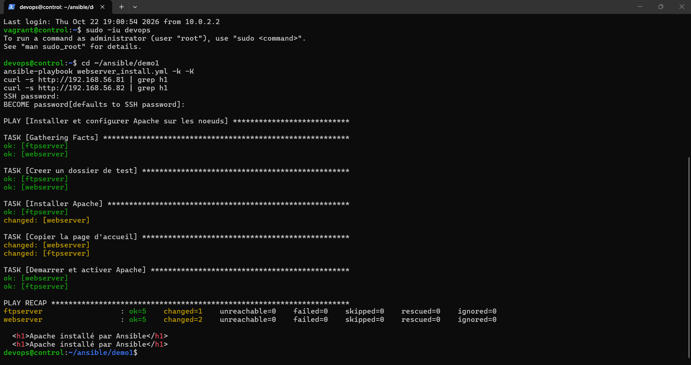
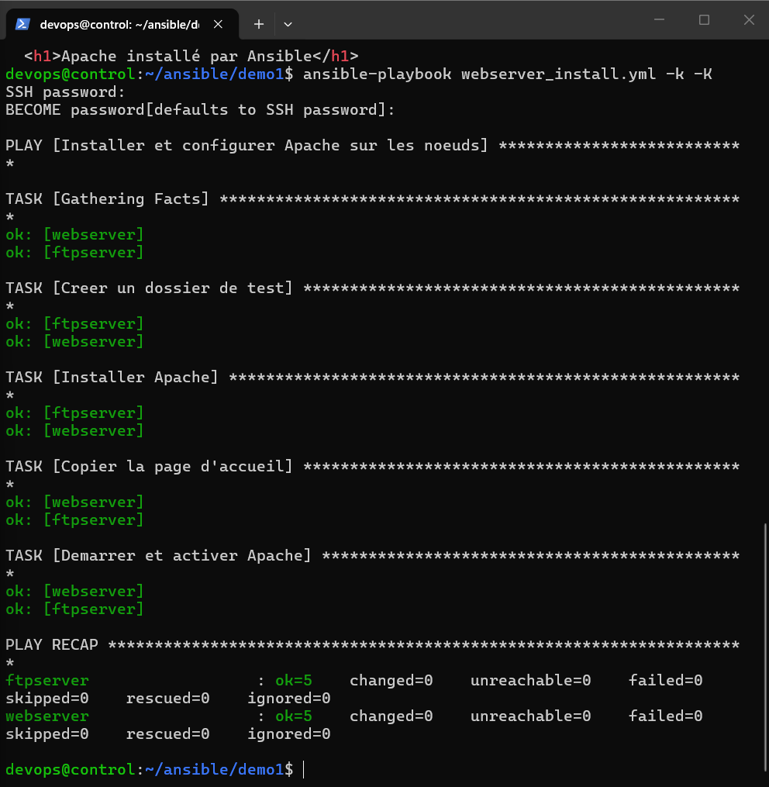
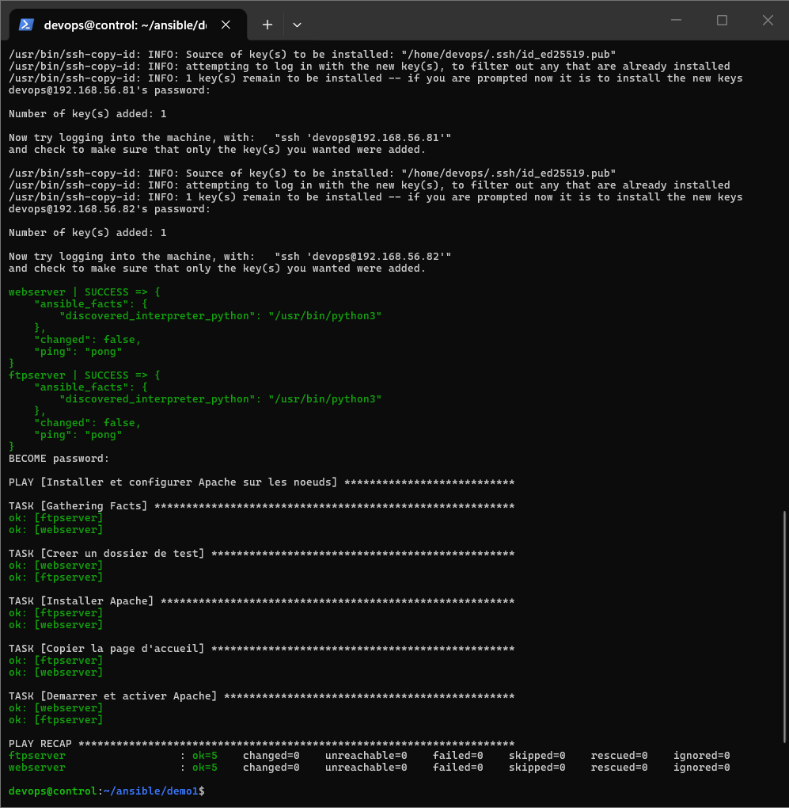
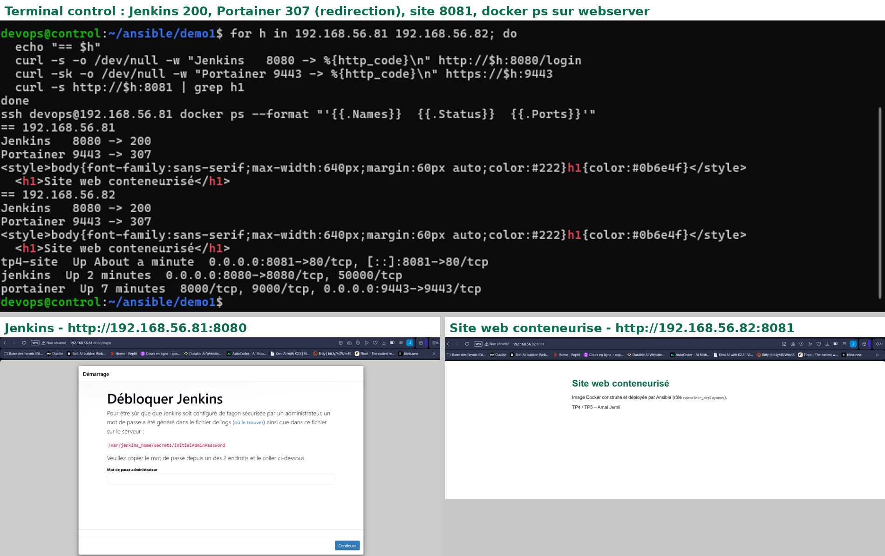
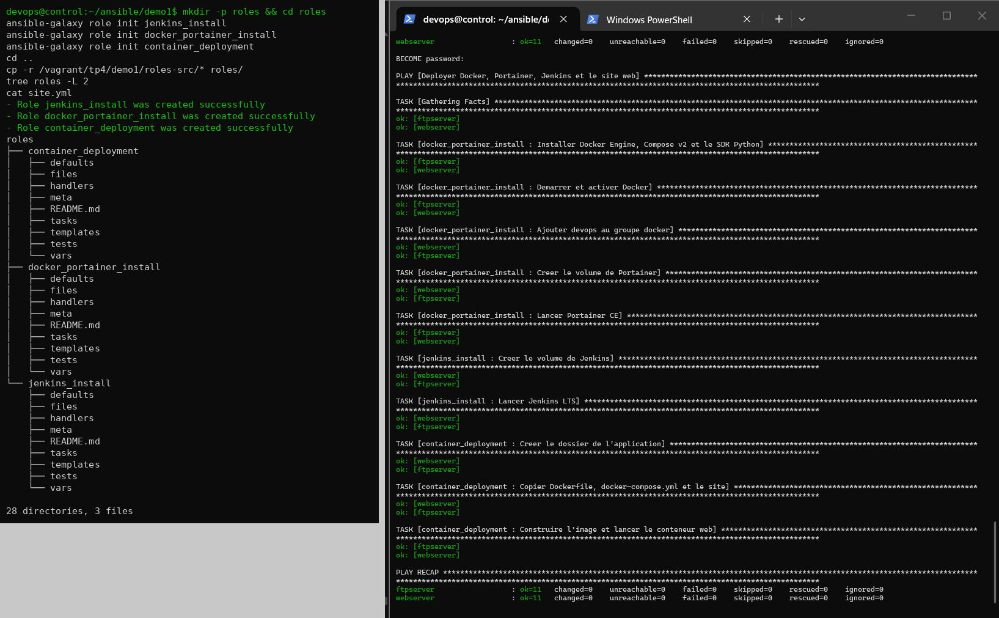

# TP4 – Bases d'Ansible

**Étudiante :** Amal Jemli – **Énoncé :** [TP4 – Bases d'Ansible](https://docs.teknolabs.net/courses/devops-cloud/partie-2-automatisation-iac/tp4-ansible-bases/)

Ansible est un outil d'automatisation **sans agent** : depuis le nœud de contrôle, il se connecte en SSH aux serveurs, y exécute de petits programmes Python (les modules) et décrit l'**état voulu** plutôt que les commandes à taper.

| VM | IP | Rôle |
|---|---|---|
| `control` | 192.168.56.80 | nœud de contrôle (Ansible 9.2 / ansible-core 2.16) |
| `webserver` | 192.168.56.81 | nœud géré |
| `ftpserver` | 192.168.56.82 | nœud géré |

Les trois VM sont créées par le Vagrantfile du lab ([../tp5-vagrant/lab](../tp5-vagrant/lab)). Le script `bootstrap.sh` y crée l'utilisateur commun **`devops`** (sudo).

## Structure

```
demo1/
├── inventory.ini            # groupe [nodes] : webserver, ftpserver
├── ansible.cfg              # inventaire, remote_user = devops, host_key_checking = False (lab)
├── webserver_install.yml    # partie 2 : Apache
├── files/index.html
├── deploy_stack.yml         # partie 4 : Docker, Portainer, Jenkins, site web (un seul playbook)
├── site/                    # Dockerfile + docker-compose.yml + index.html du site web
├── site.yml                 # partie 5 : le même déploiement avec 3 rôles
└── roles/
    ├── docker_portainer_install/
    ├── jenkins_install/
    └── container_deployment/   # files/site : Dockerfile, docker-compose.yml, index.html
```

## Parties 0 et 1 – Inventaire, ansible.cfg et ping

```bash
sudo -iu devops
mkdir -p ~/ansible && cp -r /vagrant/tp4/demo1 ~/ansible/ && cd ~/ansible/demo1
ansible-inventory --graph
ansible nodes -m ping -k        # -k : mot de passe SSH (avant la partie 3)
```

Le module `ping` n'envoie pas de ping réseau : il vérifie qu'Ansible peut se connecter en SSH et exécuter Python sur chaque nœud (`"ping": "pong"`).



## Partie 2 – Premier playbook : Apache

[`webserver_install.yml`](demo1/webserver_install.yml) : dossier de test `/opt/tp4-test`, paquet `apache2`, page `index.html`, service démarré et activé.

```bash
ansible-playbook webserver_install.yml --syntax-check
ansible-playbook webserver_install.yml --check --diff -k -K   # simulation
ansible-playbook webserver_install.yml -k -K
curl -s http://192.168.56.81 | grep h1
curl -s http://192.168.56.82 | grep h1
```

En mode `--check`, la dernière tâche échoue (« Could not find the requested service apache2 ») : le paquet n'est pas réellement installé pendant la simulation, donc le service n'existe pas encore. C'est une limite connue du mode `--check` quand les tâches dépendent les unes des autres.



### Idempotence

Le second passage ne change rien : chaque module compare l'état réel à l'état demandé.



## Partie 3 – Clés SSH

```bash
ssh-keygen -t ed25519 -N "" -f ~/.ssh/id_ed25519
ssh-copy-id devops@192.168.56.81
ssh-copy-id devops@192.168.56.82
ansible nodes -m ping                       # plus de -k
ansible-playbook webserver_install.yml -K   # seul le mot de passe sudo reste demandé
```

La clé privée reste sur `control` ; seule la clé publique est copiée dans `~/.ssh/authorized_keys` des nœuds.



## Partie 4 – Docker, Portainer, Jenkins et conteneur web

[`deploy_stack.yml`](demo1/deploy_stack.yml) :

| Service | Mise en œuvre | Port |
|---|---|---|
| Docker Engine + Compose v2 | paquets `docker.io`, `docker-compose-v2`, `python3-docker` | – |
| Portainer CE | conteneur `portainer/portainer-ce:lts` (module `community.docker.docker_container`) | 9443 (HTTPS) |
| Jenkins LTS | conteneur `jenkins/jenkins:lts-jdk21`, volume `jenkins_home` | 8080 |
| Site web | image construite depuis [`site/Dockerfile`](demo1/site/Dockerfile) (nginx:alpine), lancée par [`docker-compose.yml`](demo1/site/docker-compose.yml) (module `docker_compose_v2`) | 8081 |

Le site web est sur le port 8081 : le port 80 est déjà pris par Apache (partie 2) et le 8080 par Jenkins. L'image est construite localement sur chaque nœud (option prévue par l'énoncé), sous le nom `amal878/tp4-site:1.0`.

```bash
ansible-playbook deploy_stack.yml -K
```

Vérification : Jenkins répond 200, Portainer 307 (redirection vers sa page de connexion), le site affiche son titre, et `docker ps` sur `webserver` liste les 3 conteneurs.



## Partie 5 – Rôles

```bash
mkdir -p roles && cd roles
ansible-galaxy role init jenkins_install
ansible-galaxy role init docker_portainer_install
ansible-galaxy role init container_deployment
cd ..
ansible-playbook site.yml -K
ansible-playbook site.yml -K
```

Les tâches de `deploy_stack.yml` sont réparties dans les trois rôles ([`site.yml`](demo1/site.yml)). Comme tout était déjà déployé, les deux passages donnent `changed=0` : le découpage en rôles ne change pas le résultat.



## Difficultés rencontrées

| Problème | Solution |
|---|---|
| Ansible ignore un `ansible.cfg` placé dans un dossier partagé Windows (accessible en écriture à tous) | Projet copié dans `~/ansible/demo1` sur `control` |
| Les commandes collées après `sudo -iu devops` ne s'exécutaient pas (nouveau shell) | Ouvrir la session `devops`, puis coller les commandes |
| Avertissement *pull access denied for amal878/tp4-site* | Compose cherche d'abord l'image sur Docker Hub, puis la construit localement (`web Built`) ; sans effet sur le résultat |
| Certificat auto-signé de Portainer refusé par le navigateur | Accès vérifié par `curl -k` (code 307) et `docker ps` |
