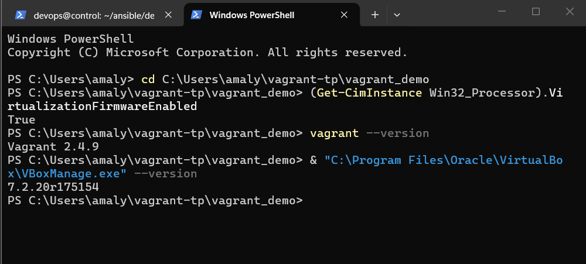
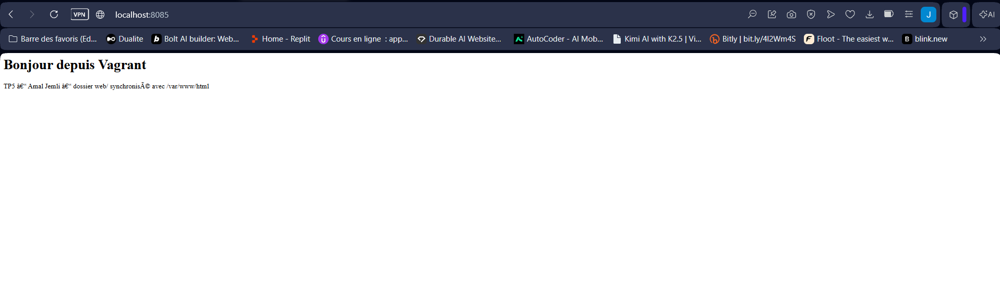
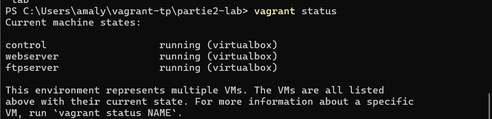
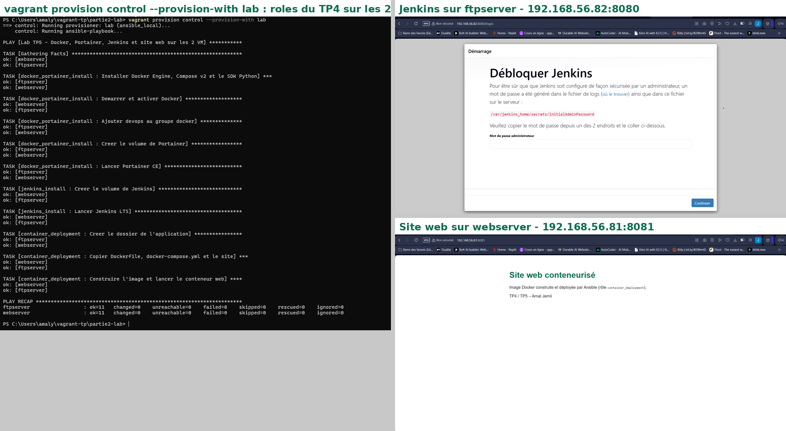

# TP5 – Environnements de lab reproductibles avec Vagrant

**Étudiante :** Amal Jemli – **Énoncé :** [TP5 – Vagrant](https://docs.teknolabs.net/courses/devops-cloud/partie-2-automatisation-iac/tp5-vagrant/)

Vagrant décrit des machines virtuelles dans un fichier texte (`Vagrantfile`) : box de départ, réseau, ressources, dossiers partagés et provisionnement. `vagrant up` recrée le même environnement sur n'importe quel poste.

## Structure

```
tp5-vagrant/
├── vagrant_demo/        # démo : VM Apache, dossier synchronisé, redirection de port
│   ├── Vagrantfile
│   └── web/index.html
└── lab/                 # lab : 3 VM (control + 2 noeuds) provisionnées par Ansible
    ├── Vagrantfile
    ├── bootstrap.sh     # utilisateur devops, /etc/hosts, Ansible sur control
    └── tp5/
        ├── site.yml     # les 3 rôles du TP4
        ├── inventory.ini
        └── roles/       # roles du TP4 (docker-compose.yml dans container_deployment/files/site)
```

## 1. Virtualisation

L'énoncé prévoit une VM Hyper-V qui héberge VirtualBox, ce qui impose d'activer la virtualisation imbriquée. Ici, **VirtualBox 7.2 et Vagrant 2.4.9 sont installés directement sur Windows** : il n'y a pas de couche Hyper-V intermédiaire, donc pas besoin de virtualisation imbriquée. L'équivalent est vérifié : la virtualisation matérielle (VT-x/AMD-V) est activée sur le processeur.

```powershell
(Get-CimInstance Win32_Processor).VirtualizationFirmwareEnabled   # True
vagrant --version                                                 # Vagrant 2.4.9
& "C:\Program Files\Oracle\VirtualBox\VBoxManage.exe" --version   # 7.2.20
```



## 2. Démo : serveur web Apache

[`vagrant_demo/Vagrantfile`](vagrant_demo/Vagrantfile) reprend celui de l'énoncé : box `bento/ubuntu-24.04`, VM `vagrant-web1` (1 Go, 2 CPU), provisionnement shell d'Apache, dossier `web/` synchronisé avec `/var/www/html`.

```powershell
cd vagrant_demo
vagrant up
# navigateur : http://localhost:8085
vagrant destroy -f
```

**Port 8085 au lieu de 8080 :** au premier `vagrant up`, Vagrant a refusé la redirection, car le port 8080 du PC était déjà utilisé par le Jenkins d'une autre VM. Le port hôte a été changé dans le Vagrantfile.



## 3. Lab : 2 VM provisionnées par Vagrant et Ansible

[`lab/Vagrantfile`](lab/Vagrantfile) définit 3 machines dans une boucle, sur un réseau `private_network` :

| VM | IP | RAM | Rôle |
|---|---|---|---|
| `webserver` | 192.168.56.81 | 2,5 Go | nœud : Docker, Portainer, Jenkins, site web |
| `ftpserver` | 192.168.56.82 | 2,5 Go | nœud : idem |
| `control` | 192.168.56.80 | 1 Go | nœud de contrôle Ansible (défini en dernier) |

**Provisionnement Ansible depuis Windows.** Le provisioner `ansible` de Vagrant exécute Ansible sur l'hôte, ce qui n'est pas possible sous Windows. Le lab utilise donc **`ansible_local`** sur la VM `control` (où Ansible est installé), avec `limit = "all"` : depuis `control`, il applique les **rôles du TP4** aux deux nœuds.

```ruby
node.vm.provision "lab", type: "ansible_local" do |ansible|
  ansible.install           = false
  ansible.provisioning_path = "/vagrant/tp5"
  ansible.playbook          = "site.yml"
  ansible.inventory_path    = "inventory.ini"
  ansible.limit             = "all"
end
```

```powershell
cd lab
vagrant up
vagrant status
vagrant provision control --provision-with lab
```



Le provisionnement donne `changed=0` : les services installés au TP4 sont déjà dans l'état décrit par les rôles. Jenkins, Portainer et le site web répondent sur les deux VM (voir aussi [containers.png](../tp4-ansible-bases/captures/containers.png) pour `webserver:8080` et `ftpserver:8081`).



## Commandes Vagrant utilisées

| Commande | Rôle |
|---|---|
| `vagrant up` | créer, démarrer et provisionner |
| `vagrant status` / `vagrant global-status --prune` | état des VM du projet / de tout le poste |
| `vagrant ssh control` | se connecter à une VM |
| `vagrant provision control --provision-with lab` | relancer un provisioner précis |
| `vagrant halt` / `vagrant destroy -f` | arrêter / supprimer |
| `vagrant box list` | boxes téléchargées (`bento/ubuntu-24.04` réutilisée par toutes les VM) |

## Difficultés rencontrées

| Problème | Solution |
|---|---|
| Disque C: limité (21 Go libres) | Suppression des VM des TP déjà rendus (`vagrant destroy` par identifiant) : 45 Go libres |
| Port 8080 déjà utilisé sur l'hôte | Démo sur le port 8085 |
| Provisioner `ansible` indisponible sous Windows | `ansible_local` exécuté depuis `control` |
| Page Apache non rafraîchie après modification de `web/index.html` | Cache `sendfile` d'Apache sur un dossier partagé VirtualBox (problème connu) ; la synchronisation des fichiers fonctionne |
