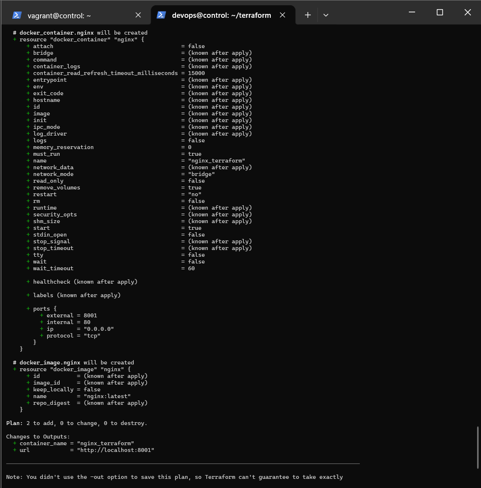
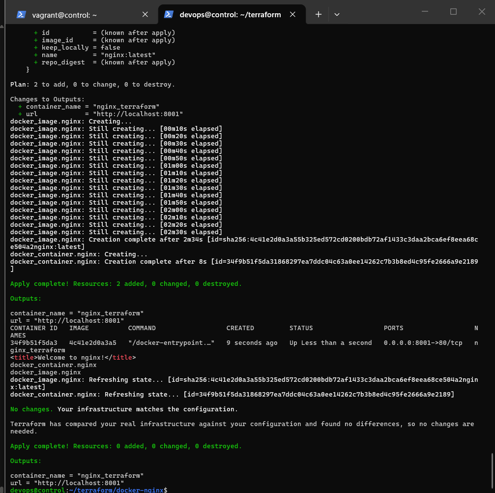
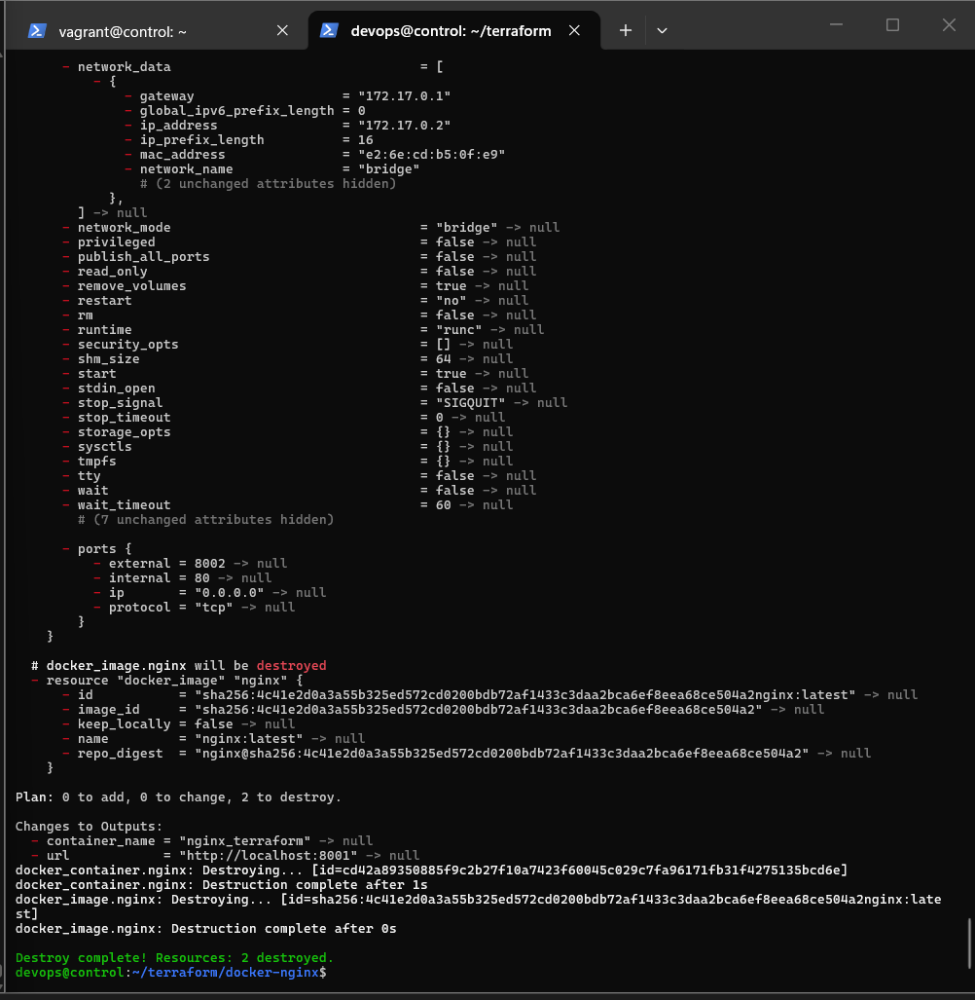
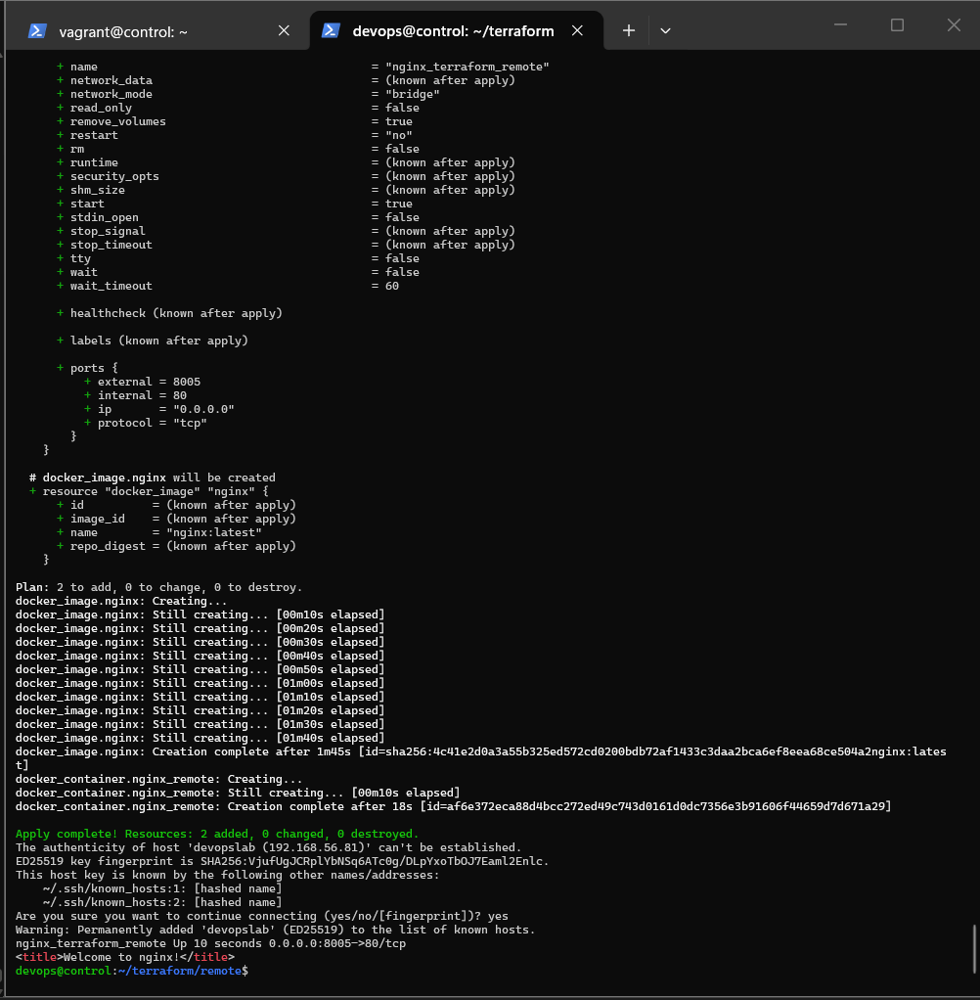
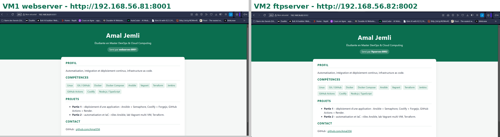
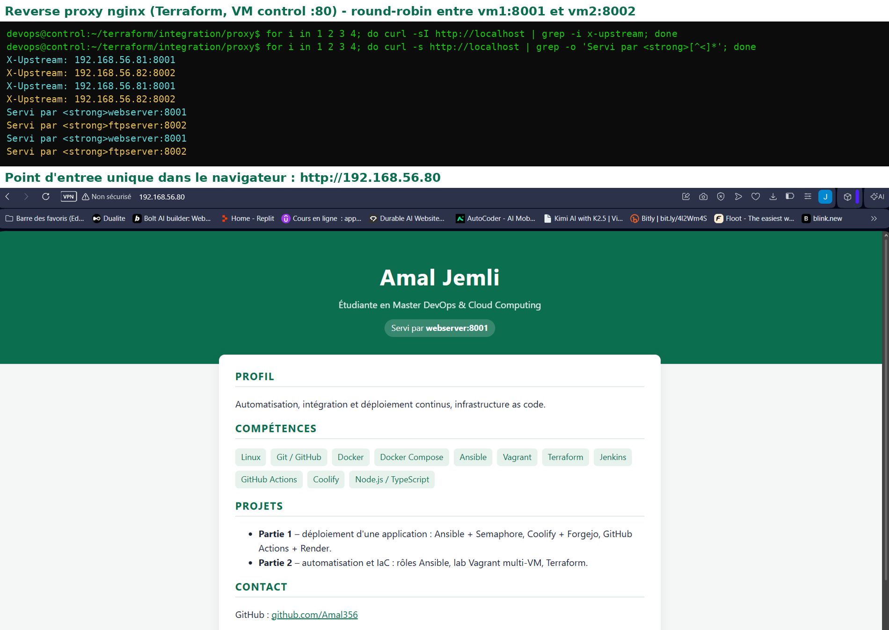

# TP6 – Infrastructure as Code avec Terraform (et intégration Vagrant + Ansible)

**Étudiante :** Amal Jemli – **Énoncé :** [TP6 – Terraform](https://docs.teknolabs.net/courses/devops-cloud/partie-2-automatisation-iac/tp6-terraform/)

Terraform décrit une infrastructure de façon **déclarative** (langage HCL). `plan` compare l'état voulu au fichier d'état `terraform.tfstate` et à la réalité, puis `apply` fait les changements nécessaires, et seulement eux.

## Structure

```
tp6-terraform/
├── install_tools.sh          # Docker + Terraform (dépôt apt HashiCorp) sur la VM control
├── docker-nginx/             # 1. Docker local : main.tf, variables.tf, outputs.tf, .terraform.lock.hcl
├── remote/                   # 2. Docker distant via SSH (devopslab = webserver)
└── integration/              # 3. Vagrant -> Ansible -> Terraform
    ├── vagrant/              #    Vagrantfile + bootstrap.sh (les 2 VM du lab + control)
    ├── cv/                   #    CV one page HTML5/CSS3 + Dockerfile (image amal878/cv-onepage:1.0)
    ├── integration.yml       #    playbook : Docker + Terraform sur les 2 VM, puis terraform apply
    ├── inventory.ini         #    cv_port = 8001 (webserver) / 8002 (ftpserver)
    ├── terraform/            #    main.tf + variables.tf du conteneur CV
    └── proxy/                #    défi : reverse proxy nginx (main.tf, nginx.conf, .terraform.lock.hcl)
```

`terraform.tfstate`, `.terraform/` et `*.tfvars` ne sont pas versionnés (`.gitignore`) : l'état peut contenir des données sensibles, et le dossier `.terraform/` contient les binaires des providers. Le fichier `.terraform.lock.hcl`, lui, est versionné : il fige la version du provider (`kreuzwerker/docker` **3.9.0**) pour obtenir la même installation partout.

## 0. Installation (VM `control`)

```bash
sudo bash /vagrant/tp6/install_tools.sh    # docker.io 29.1, terraform 1.17.0, devops dans le groupe docker
sudo -iu devops                            # nouvelle session : groupe docker pris en compte
docker ps                                  # sans sudo
```

## 1. Exemple Docker local : nginx

[`docker-nginx/main.tf`](docker-nginx/main.tf) : provider `kreuzwerker/docker ~> 3.0` (socket local), une ressource `docker_image` (`nginx:latest`) et une ressource `docker_container` (`nginx_terraform`, port `var.external_port` → 80).

```bash
cd docker-nginx
terraform init        # télécharge le provider, crée .terraform.lock.hcl
terraform fmt
terraform validate
terraform plan
```



```bash
terraform apply -auto-approve
docker ps
curl -s http://localhost:8001 | grep title     # <title>Welcome to nginx!</title>
terraform state list
terraform apply -auto-approve                  # No changes : idempotence
```



### Variables et nettoyage

[`variables.tf`](docker-nginx/variables.tf) déclare `external_port` (type `number`, défaut 8001).

```bash
terraform apply -auto-approve -var external_port=8002   # le conteneur est remplacé, il passe sur 8002
terraform destroy -auto-approve                         # Destroy complete! Resources: 2 destroyed.
```

Changer un port publié force le remplacement du conteneur (`must be replaced`) : Docker ne permet pas de modifier les ports d'un conteneur existant.



## 2. Docker distant via SSH

[`remote/main.tf`](remote/main.tf) pilote le Docker de la VM `devopslab` (alias de `webserver`, 192.168.56.81, ajouté dans `/etc/hosts`) à travers SSH. Les prérequis sont ceux du TP4 : Docker installé, `devops` dans le groupe `docker`, clé SSH sans mot de passe.

```hcl
provider "docker" {
  host     = "ssh://devops@devopslab:22"
  ssh_opts = ["-o", "StrictHostKeyChecking=no", "-o", "UserKnownHostsFile=/dev/null"]
}
```

```bash
cd remote
terraform init && terraform apply -auto-approve
ssh devops@devopslab "docker ps --filter name=nginx_terraform_remote"
curl -s http://devopslab:8005 | grep title
terraform destroy -auto-approve
```

Le port 8005 évite les ports 8001 et 8002, réservés au CV.



## 3. Intégration Vagrant + Ansible + Terraform

1. **Vagrant** crée les VM ([`integration/vagrant/Vagrantfile`](integration/vagrant/Vagrantfile), box `bento/ubuntu-24.04`).
2. **Image du CV** : [`cv/`](integration/cv) (HTML5/CSS3, `FROM nginx:alpine`). Un script de démarrage remplace `__HOST__` par la variable `CV_HOST`, ce qui affiche dans la page le serveur qui la sert.
   ```bash
   docker build -t amal878/cv-onepage:1.0 .
   docker login -u amal878          # mot de passe saisi à la main
   docker push amal878/cv-onepage:1.0
   docker logout
   ```
3. **Ansible** ([`integration.yml`](integration/integration.yml)) installe Docker et Terraform (dépôt HashiCorp) sur les 2 VM, copie [`terraform/`](integration/terraform) dans `/opt/cv-terraform`, puis lance Terraform avec le module `community.general.terraform` et la variable `external_port` propre à chaque hôte :
   ```bash
   ansible-playbook integration.yml -K
   ```

| VM | URL | Badge affiché |
|---|---|---|
| vm1 `webserver` | http://192.168.56.81:8001 | Servi par webserver:8001 |
| vm2 `ftpserver` | http://192.168.56.82:8002 | Servi par ftpserver:8002 |



## Défi – Reverse proxy nginx

[`proxy/main.tf`](integration/proxy/main.tf) lance sur `control` un conteneur `nginx:alpine` publié sur le port 80. Sa configuration ([`nginx.conf`](integration/proxy/nginx.conf)) est injectée par Terraform (bloc `upload`). Le bloc `upstream` répartit les requêtes entre les deux CV (round-robin) ; l'en-tête `X-Upstream` indique le serveur choisi.

```bash
cd integration/proxy
terraform init && terraform apply -auto-approve
for i in 1 2 3 4; do curl -sI http://localhost | grep -i x-upstream; done
```

Point d'entrée unique : **http://192.168.56.80**. Les requêtes alternent entre `192.168.56.81:8001` et `192.168.56.82:8002`. Le navigateur, lui, réutilise souvent la même connexion et son cache : l'alternance se voit mieux avec `curl`.



## Difficultés rencontrées

| Problème | Solution |
|---|---|
| `docker login` a lu la ligne collée suivante comme mot de passe (`incorrect username or password`) | Commandes tapées une par une |
| Mot de passe Docker Hub oublié | Récupération du compte, puis connexion |
| `docker ps` refusé juste après l'installation | Nouvelle session `devops` pour appliquer le groupe `docker` |
| Ports déjà utilisés sur les VM (80 Apache, 8080 Jenkins, 8081 site) | CV sur 8001/8002, Docker distant sur 8005, proxy sur `control` |
